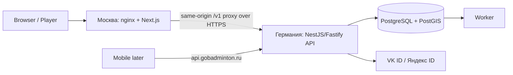

# Архитектура системы v1

Статус: **TECH_SELECTED** по OD-006/OD-010.

## MVP physical topology

MVP split:
- `gobadminton.ru` / `www.gobadminton.ru` → Moscow web host;
- `dev-api.gobadminton.ru` → German backend host;
- `api.gobadminton.ru` = stable future production API name.

API and PostgreSQL stay together in Germany. Moscow never performs direct DB access.

Browser calls relative `/v1/*` through Moscow nginx. This preserves same-origin browser semantics and allows backend transport/location to change without changing UI contracts.

## Backend

One backend ownership boundary and one primary DB. API + worker are processes of one release, not independent microservices.

Layering:
`HTTP controllers → application use cases → domain policies → repository/provider ports → adapters`.

## Network resilience

Direct HTTPS Moscow→Germany is the default. Measure RTT/loss/jitter before adding infrastructure.

If Russia↔Germany routing proves unstable, add a dedicated GoBadminton tunnel beneath the proxy/upstream boundary. Application/API semantics stay unchanged.

## Start constraints

No microservices/Kubernetes/Kafka/GraphQL/event sourcing/CMS dependency for transactional domain. No DB split across Moscow/Germany.

## Data/legal boundary

The technical topology does not itself establish legal compliance for public personal-data processing. With primary DB in Germany, public real-data launch still requires O-02 review.

Details: [STACK](STACK.md), [MODULE_BOUNDARIES](MODULE_BOUNDARIES.md), [ENVIRONMENTS](../operations/ENVIRONMENTS.md), [MVP runtime](../operations/MVP_VPS_RUNTIME.md), [ADR](../decisions/README.md).
